<!--
  [ SYSTEM ] Player: Saumya
  Every panel is generated. Edit scripts/system/content.py, then run `python3 scripts/build.py static`.
  status.svg and daily-quest.svg are rebuilt by .github/workflows/system.yml and served from the `output` branch.
-->

  

  
  

  

  
   
  
  
  
  

  <b>LIVE GATES</b> · <a href="https://d1eau8jaupf0cp.cloudfront.net">Prism demo</a> · <a href="https://campusly.us">campusly.us</a>
   
  <b>CLEARED DUNGEONS</b> · <a href="https://github.com/Saumya-patel-31/Visionary">Visionary</a> (Bitcamp 2025) · <a href="https://github.com/Saumya-patel-31/Moodmap">Moodmap</a> · <a href="https://github.com/Saumya-patel-31/PlantMate">PlantMate</a>

  

  

  

